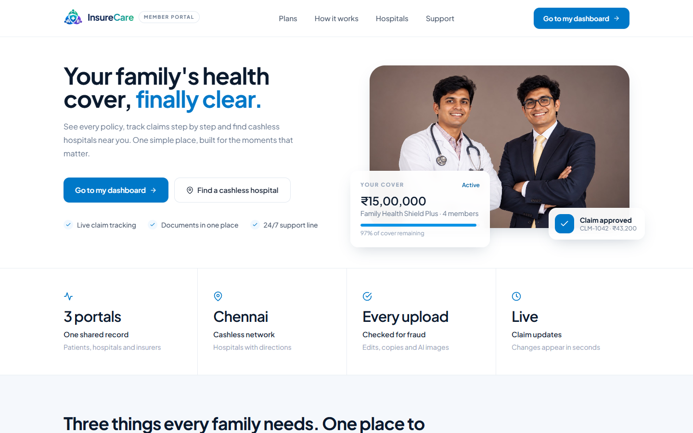
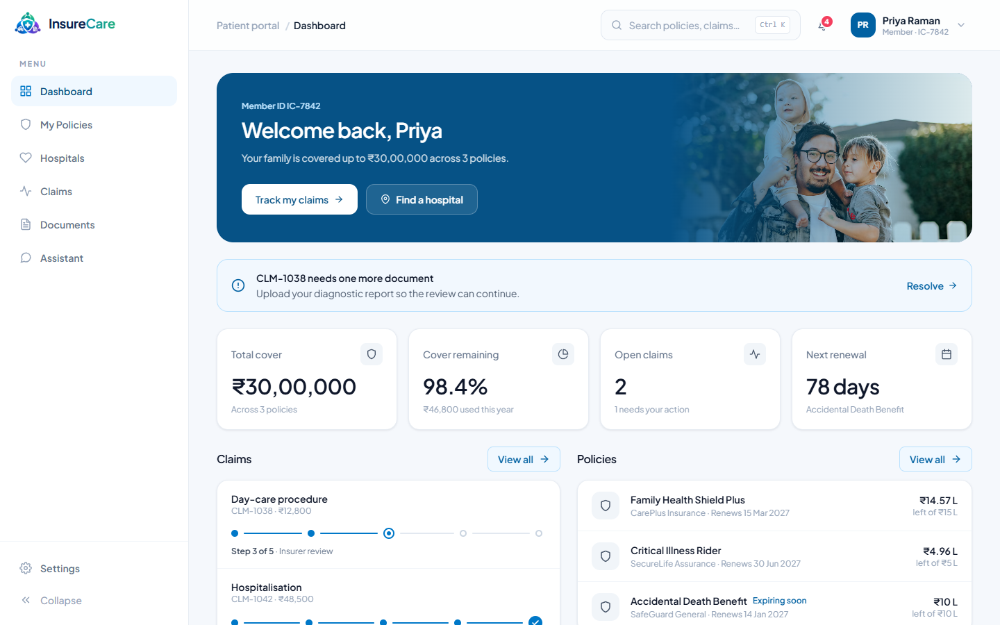
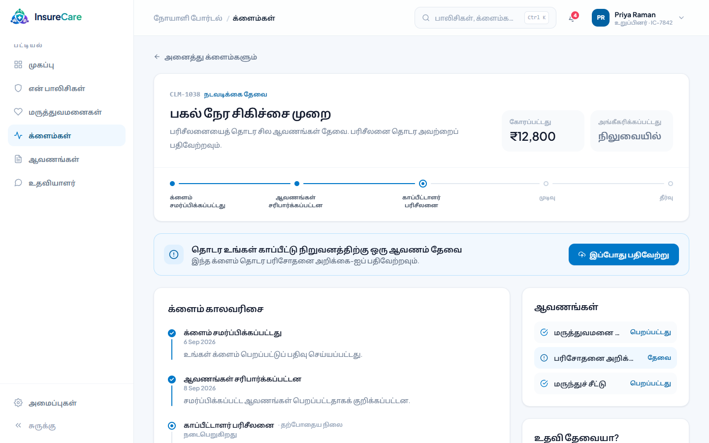
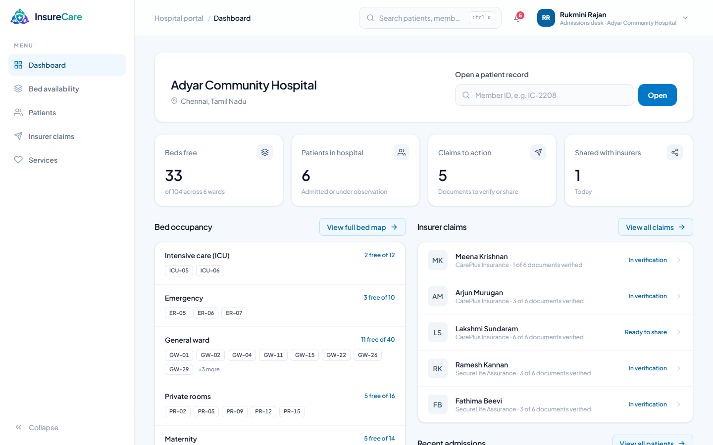
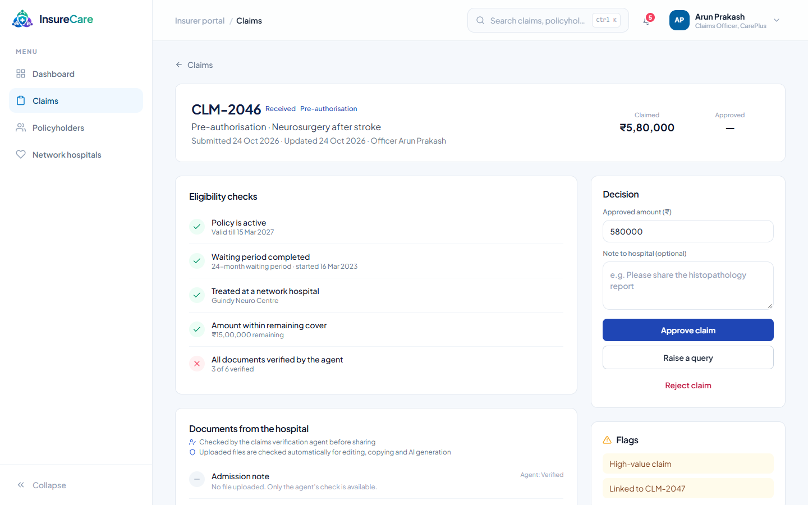

# InsureCare

> Health cover, claims and care in one place, for patients, hospitals and insurers in Tamil Nadu.



InsureCare connects the three people in every health-insurance claim. **Patients** see their cover, follow claims and keep their medical documents. **Hospital desks** manage beds and admissions and send verified documents to the insurer. **Insurers** review claims, with every uploaded document checked automatically for signs of fraud. A change in one portal appears in the others within seconds.

---

## Features

| | |
|---|---|
| **Three portals, one record** | Patient, hospital and insurer portals on the same data, updated live over a WebSocket. |
| **Sign-in and access control** | Every account sees only its own data: a patient their records, a hospital its patients, an insurer its claims. |
| **Ask InsureCare (AI assistant)** | Answers a patient's questions from their own policies, claims, hospital stays, medical history and documents, streamed as it writes (Groq, free tier). |
| **Document fraud checks** | Each hospital upload is checked for editing, copying from another patient and AI generation, with OCR in English and Tamil. |
| **Tamil** | The patient portal and sign-in page in English or தமிழ், chosen in Settings. |
| **Cashless hospital finder** | Network hospitals in Chennai with filters, coverage check and Google Maps directions. |
| **Works on phones** | Responsive layouts with bottom navigation; open it on a phone on the same Wi-Fi. |

<table>
<tr>
<td></td>
<td></td>
</tr>
<tr>
<td></td>
<td></td>
</tr>
</table>

---

## Architecture

```
┌──────────────┐  /api (same origin)  ┌──────────────┐      ┌──────────────┐
│   Frontend   │─────────────────────▶│   Backend    │─────▶│  PostgreSQL  │
│  Next.js 16  │◀── live updates ─────│ Spring Boot  │      └──────────────┘
└──────────────┘      (WebSocket)     └──────┬───────┘
                                             │
                         ┌───────────────────┼───────────────────┐
                         ▼                                       ▼
                ┌─────────────────┐                     ┌─────────────────┐
                │    Verifier     │                     │    Groq API     │
                │ Python: OCR,    │                     │  AI assistant   │
                │ AI-image model  │                     │  (free tier)    │
                └─────────────────┘                     └─────────────────┘
```

| Part | Stack | Details |
|---|---|---|
| `frontend/` | Next.js 16, React 19, TypeScript, Tailwind | Portals, sign-in, Tamil translations (`src/locales/ta.json`) |
| `backend/` | Java 25, Spring Boot 3.5, Spring Security, JPA, Flyway | REST API, sessions, access rules, document checks, assistant. See [backend/README.md](backend/README.md) |
| `verifier/` | Python, FastAPI, Tesseract, PyTorch | OCR (English + Tamil), error level analysis, AI-image classifier. Runs locally; documents never leave the machine |
| Database | PostgreSQL 16 | Seeded with Chennai demo data on first start |

---

## Run it

You need **Docker** and **Node.js 20.9+**.

```bash
# 1. Settings: copy the example and add a free Groq key (console.groq.com) for the assistant
cp .env.example .env

# 2. Database, verifier and API on http://localhost:8080
docker compose up -d

# 3. Portals on http://localhost:3000
cd frontend
cp .env.example .env.local
npm install
npm run dev
```

The verifier's first build downloads about 2 GB (PyTorch and the image model). Without a Groq key everything works except the assistant.

### Demo accounts

Password for all: `insurecare`

| Sign in with | Who | Portal |
|---|---|---|
| `IC-7842` | Priya Raman, patient (other members: their member ID) | Patient |
| `rukmini.rajan@adyarcommunity.example` | Rukmini Rajan, Adyar Community Hospital desk | Hospital |
| `arun.prakash@careplus.example` | Arun Prakash, CarePlus claims officer | Insurer |

### On a phone

1. Connect the phone to the same Wi-Fi as the computer.
2. Start the portals with `npm run dev -- --hostname 0.0.0.0` (in `frontend/`).
3. Find the computer's address (`ipconfig` on Windows, "IPv4 Address" under Wi-Fi) and open `http://<that address>:3000` on the phone.
4. To sign in from the phone, add your network to `ALLOWED_ORIGINS` in `.env`, e.g. `http://192.168.*:3000` or `http://10.*:3000` (`*` matches any part, so a new Wi-Fi address still works), and run `docker compose up -d backend`.

### Tests

```bash
cd backend && ./mvnw test            # 33 tests: access rules, assistant, document checks, claims
cd frontend && npx tsc --noEmit && npm run build
```

---

## Status and limits

Working prototype with demo data. Before real patients use it:

- **Accounts** exist only as demo data: no sign-up, password change or reset, and no limit on wrong password attempts yet.
- **Patient data and the AI:** each assistant question sends that patient's records to Groq. Get consent, or point `ASSISTANT_URL` at a model on your own server (e.g. Ollama).
- **Groq's free tier** allows only a few questions a minute in total. Each visitor may ask 10 questions an hour (`ASSISTANT_QUESTIONS_PER_HOUR`).
- **Public demo:** set `DEMO_RESET=0 0 3 * * *` to put the demo data back every night, undoing visitors' changes and deleting their uploads. Upload forms warn visitors not to upload real documents.
- **HTTPS:** serve the portals over HTTPS and set `SESSION_COOKIE_SECURE=true`; hide the demo accounts with `NEXT_PUBLIC_SHOW_DEMO_ACCOUNTS=false`.
- Hospital names are made up; addresses are real Chennai streets. Photos are from Unsplash.

---

## License

[MIT](LICENSE)
